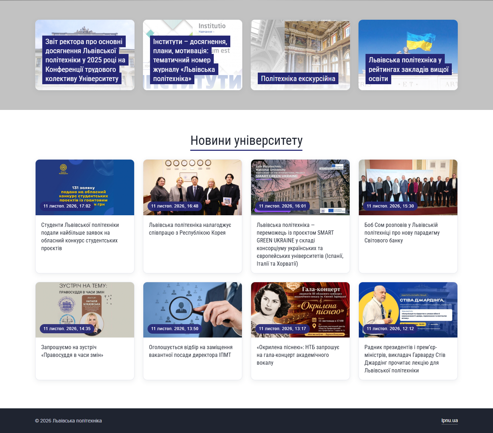
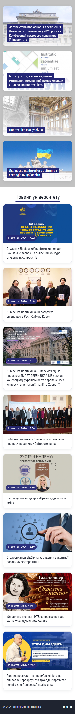

# Лабораторна робота №7

**Тема:** Використання CSS Flexbox, Grid Layout, transitions та animations для верстки сторінки новин

**Варіант:** 3 — `header#featured_container`

**Дисципліна:** Програмування в Internet

**Виконав:** студент групи ТК-42

---

## 1. Мета роботи

Закріпити навички створення адаптивної верстки вебсторінок із використанням Flexbox, CSS Grid та медіа-запитів. На прикладі головної сторінки сайту [lpnu.ua](https://lpnu.ua/) проаналізувати принципи реалізації адаптивного макета та відтворити фрагмент сторінки — блок новин.

## 2. Завдання (варіант 3)

1. Зверстати блок `header#featured_container` з головної сторінки lpnu.ua, використовуючи **Flexbox** для гнучкого вирівнювання та розподілу простору.
2. Зверстати блок `main`, що містить блок «Новини університету», всередині `div.main-container`, використовуючи **CSS Grid** для сітки новин.
3. Додати медіа-запити для трьох брейкпоінтів (і для новин, і для header):
   - Mobile (до 767 px) — 1 колонка;
   - Tablet (768–1023 px) — 2 колонки;
   - Desktop (1024 px і більше) — 4 колонки.
4. Додати посилання на `lab7/index.html` у меню головної сторінки лабораторних.
5. Перевірити адаптивність у браузері, оформити звіт і дати відповіді на питання вихідного контролю.

## 3. Структура проєкту

```
lab7/
├── index.html          # розмітка сторінки
├── css/
│   └── styles.css      # стилі, Flexbox, Grid, медіа-запити, анімації
├── img/                # 12 локальних зображень новин
├── screenshots/        # скріншоти для звіту
└── README.md           # цей звіт
```

Сторінка містить:

- `header#featured_container` — 4 обрані новини (Flexbox);
- `main > div.main-container` — блок «Новини університету» з 8 картками (CSS Grid);
- підвал.

## 4. Хід виконання

### 4.1. Блок `header#featured_container` — Flexbox

Контейнер карток:

```css
.featured-flex {
    display: flex;
    flex-wrap: wrap;
    align-items: stretch;
    justify-content: space-between;
    gap: var(--gap);
}
```

Картки отримують гнучку ширину залежно від брейкпоінта:

```css
.featured-card {
    flex: 1 1 100%;                  /* mobile — 1 колонка */
    min-width: 0;
}
```

Усередині картки поєднано Flexbox і Grid: посилання є грід-контейнером із однією коміркою, у якій стеком лежать зображення, градієнт і заголовок:

```css
.featured-card > a {
    display: grid;
    grid-template-areas: "card";
    height: 100%;
}

.featured-card > a > * {
    grid-area: card;
}

.featured-card h2 {
    align-self: end;
}
```

Це дозволяє заголовку бути притиснутим донизу, а картці — розтягуватися під довший текст без обрізання.

### 4.2. Блок `main > div.main-container` — CSS Grid

```css
.news-grid {
    display: grid;
    grid-template-columns: minmax(0, 1fr);   /* mobile */
    gap: var(--gap);
}
```

Картки новин мають однакову висоту в межах рядка, а внутрішнє посилання розтягується на всю картку за допомогою Flexbox:

```css
.news-card-link {
    display: flex;
    flex-direction: column;
    height: 100%;
}
```

### 4.3. Transitions та animations

Переходи (transitions):

- зображення featured-картки: `opacity` та `transform` (масштабування при наведенні);
- фон заголовка `h2 span`: `background` (зміна кольору з `#252775` на `#00a1e4`);
- градієнт `.shadow_featured`: `opacity`;
- картки новин: `transform`, `box-shadow`, `border-color`;
- заголовок розділу: анімоване підкреслення.

Анімації (`@keyframes`):

```css
@keyframes card-fade-up {
    from { opacity: 0; transform: translateY(24px); }
    to   { opacity: 1; transform: translateY(0); }
}

@keyframes line-grow {
    from { transform: scaleX(0); }
    to   { transform: scaleX(1); }
}
```

Картки з'являються зі зсувом уверх, для кожної наступної картки додано затримку (`animation-delay`), а підкреслення заголовка «Новини університету» плавно «виростає» зліва направо.

Для доступності додано `@media (prefers-reduced-motion: reduce)`, який вимикає анімації та переходи для користувачів із відповідним налаштуванням системи.

### 4.4. Медіа-запити

Реалізовано mobile-first підхід:

```css
/* Mobile: до 767 px — 1 колонка (стилі за замовчуванням) */

/* Tablet: 768–1023 px — 2 колонки */
@media (min-width: 768px) {
    .featured-card { flex-basis: calc((100% - var(--gap)) / 2); }
    .news-grid { grid-template-columns: repeat(2, minmax(0, 1fr)); }
}

/* Desktop: 1024 px і більше — 4 колонки */
@media (min-width: 1024px) {
    .featured-card { flex-basis: calc((100% - 3 * var(--gap)) / 4); }
    .news-grid { grid-template-columns: repeat(4, minmax(0, 1fr)); }
}
```

### 4.5. Головна сторінка лабораторних

У `index.html` створено меню з картками лабораторних робіт. Додано посилання на `lab7/`:

```html
<a class="lab-card" href="lab7/">
    <div><strong>Лабораторна робота #7</strong><span>Flexbox, Grid, transitions, animations</span></div>
</a>
```

### 4.6. Типографіка

Шрифти підключено так само, як у лабораторній роботі №5:

```html
<link rel="stylesheet"
      href="https://fonts.googleapis.com/css?family=Roboto+Condensed:regular,700&amp;subset=cyrillic,cyrillic-ext">
```

- заголовки (`h2`, `h3`, бренд у верхній панелі) — `'Roboto Condensed', sans-serif`;
- основний текст — стандартний стек Bootstrap 3: `"Helvetica Neue", Helvetica, Arial, sans-serif`;
- для заголовків featured-карток використано `font-style: normal; font-weight: normal;`, як у `#featured_container h2` з lab5.

## 5. Результати перевірки адаптивності

Перевірку виконано в Chrome (Playwright) на ширинах 320, 767, 768, 1023, 1024 і 1440 px.

| Ширина екрана | Блок `featured_container` | Сітка новин | Горизонтальний скрол |
|---|---|---|---|
| 320 px | 1 колонка (4 рядки) | 1 колонка (8 рядків) | немає |
| 767 px | 1 колонка (4 рядки) | 1 колонка (8 рядків) | немає |
| 768 px | 2 колонки (2 рядки) | 2 колонки (4 рядки) | немає |
| 1023 px | 2 колонки (2 рядки) | 2 колонки (4 рядки) | немає |
| 1024 px | 4 колонки (1 рядок) | 4 колонки (2 рядки) | немає |
| 1440 px | 4 колонки (1 рядок) | 4 колонки (2 рядки) | немає |

Додатково перевірено:

- усі 12 зображень завантажуються (`naturalWidth > 0`);
- у консолі браузера немає помилок і попереджень;
- hover-ефекти працюють: фон заголовка змінюється на `rgb(0, 161, 228)`, прозорість градієнта — на `0.15`, зображення масштабується (`scale(1.05)`);
- усі посилання меню лабораторних повертають HTTP 200.

### Скріншоти

**Desktop (1400 px):**



**Tablet (800 px):**


**Mobile (375 px):**



## 6. Відповіді на питання вихідного контролю

### 4.1. Які властивості CSS Flexbox використали в роботі?

- `display: flex` — створення flex-контейнерів (`.featured-flex`, `.topbar-inner`, `.news-card-link`, підвал);
- `flex-wrap: wrap` — перенесення карток на новий рядок;
- `justify-content: space-between` — рівномірний розподіл простору між картками по горизонталі;
- `align-items: stretch` — вирівнювання карток по висоті;
- `gap` — відстань між картками;
- `flex: 1 1 100%` та `flex-basis: calc(...)` — кількість колонок залежно від брейкпоінта;
- `flex-direction: column` — вертикальне розташування зображення й заголовка в картці новини;
- `min-width: 0` — запобігання переповненню flex-елементів.

### 4.2. Яким чином реалізовано сітку новин на сторінці lpnu.ua? Чим відрізняється від Вашої реалізації?

На lpnu.ua сітка новин реалізована засобами **Bootstrap 3** (Drupal Views). Використовуються класи `.row`, `.col-12`, `.col-sm-6`, `.col-md-3`, `.clearfix` із контейнером `.views-view-grid.horizontal.cols-4`. Bootstrap 3 будує сітку на **floats**: колонки мають `float: left`, ширину у відсотках (25 % для `.col-md-3`), а рядки потребують очищення (`clearfix`) та мають від'ємні відступи.

Моя реалізація відрізняється:

- використано сучасний **CSS Grid** (`display: grid`, `grid-template-columns`, `gap`) замість floats;
- немає потреби в `clearfix` і від'ємних відступах;
- відстані між картками задаються властивістю `gap`, а не padding-ами колонок;
- mobile-first медіа-запити з брейкпоінтами 768 px і 1024 px (1 → 2 → 4 колонки), тоді як Bootstrap 3 орієнтується на 768/992/1200 px;
- картки в рядку автоматично мають однакову висоту.

### 4.3. Які брейкпоінти екрана додали на сторінці?

- **Mobile:** до 767 px — 1 колонка (базові стилі без медіа-запиту);
- **Tablet:** 768–1023 px — 2 колонки (`@media (min-width: 768px)`);
- **Desktop:** 1024 px і більше — 4 колонки (`@media (min-width: 1024px)`).

Окремо додано `@media (prefers-reduced-motion: reduce)` для вимкнення анімацій, але це не брейкпоінт ширини екрана.

### 4.4. Які властивості CSS Grid Layout використали в роботі?

- `display: grid` — створення грід-контейнерів (`.news-grid`, `.featured-card > a`);
- `grid-template-columns: minmax(0, 1fr)` — одна колонка на мобільних;
- `grid-template-columns: repeat(2, minmax(0, 1fr))` — дві колонки на планшетах;
- `grid-template-columns: repeat(4, minmax(0, 1fr))` — чотири колонки на десктопі;
- `gap: 24px` — відстані між рядками й колонками;
- `grid-template-areas: "card"` та `grid-area: card` — накладання зображення, градієнта й заголовка в одній комірці featured-картки;
- `align-self: end` — притискання заголовка до нижнього краю картки;
- `minmax(0, 1fr)` — запобігання переповненню колонок довгим текстом.

## 7. Висновки

У ході лабораторної роботи відтворено фрагмент головної сторінки lpnu.ua: блок обраних новин `header#featured_container` і блок «Новини університету» в `main > div.main-container`. Для header використано Flexbox, що забезпечило гнучке вирівнювання карток, рівномірний розподіл простору та коректне перенесення на новий рядок. Для сітки новин застосовано CSS Grid, завдяки чому вдалося побудувати адаптивну сітку без floats і clearfix.

Додано три брейкпоінти (1/2/4 колонки), transitions та keyframe-анімації, а також підтримку `prefers-reduced-motion`. Перевірка в браузері підтвердила коректну роботу на ширинах від 320 до 1440 px: кількість колонок змінюється згідно з завданням, горизонтальний скрол відсутній, зображення завантажуються, помилок у консолі немає.

## 8. Перелік посилань

1. MDN Web Docs — CSS. URL: https://developer.mozilla.org/en-US/docs/Web/CSS
2. MDN Web Docs — Flexbox. URL: https://developer.mozilla.org/en-US/docs/Learn/CSS/CSS_layout/Flexbox
3. MDN Web Docs — Grids. URL: https://developer.mozilla.org/en-US/docs/Learn/CSS/CSS_layout/Grids
4. MDN Web Docs — Responsive Design. URL: https://developer.mozilla.org/en-US/docs/Learn/CSS/CSS_layout/Responsive_Design
5. MDN Web Docs — Media queries. URL: https://developer.mozilla.org/en-US/docs/Learn/CSS/CSS_layout/Media_queries
6. Chrome DevTools. URL: https://developer.chrome.com/docs/devtools
7. Git — branch. URL: https://git-scm.com/docs/git-branch
