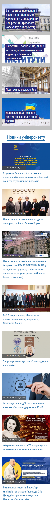

# Лабораторна робота №8

**Тема:** Використання SCSS для створення адаптивних стилів

**Дисципліна:** Програмування в Internet

**Виконав:** студент групи ТК-42 Марко Сергій

**Варіант:** 3 — `header#featured_container` (продовження лабораторної роботи №7)

---

## 1. Мета роботи

Навчитися використовувати препроцесор SASS/SCSS на прикладі верстки головної сторінки сайту [lpnu.ua](https://lpnu.ua/). Закріпити навички розробки адаптивної вебсторінки з використанням гнучких макетів та грідів.

## 2. Теоретичні відомості

### 2.1. Що таке SCSS

**SCSS** — це синтаксис препроцесора **Sass**, який поєднує можливості звичайного CSS із додатковими засобами: змінними, вкладеністю, міксинами, мапами, функціями, циклами та умовними конструкціями. Синтаксис SCSS максимально наближений до CSS, тому звичайний CSS-код є водночас валідним SCSS-кодом.

Браузер не виконує SCSS безпосередньо: файл `styles.scss` потрібно скомпілювати у звичайний `styles.css`.

### 2.2. Основні можливості SCSS

1. **Змінні** — зберігають кольори, шрифти, розміри та інші значення для повторного використання.
2. **Вкладеність** — дозволяє записувати селектори відповідно до ієрархії HTML.
3. **Міксини** — повторювані набори стилів із параметрами; підключаються через `@include`.
4. **Мапи** — асоціативні масиви «ключ — значення», зручні для зберігання брейкпоінтів або кольорів теми.
5. **Модулі та імпорти** — дозволяють розділяти стилі на кілька файлів (`@use`, `@import`).
6. **Керуючі конструкції** — `@if`, `@else`, `@for`, `@each`, `@while` для генерації повторюваних правил.

### 2.3. Компіляція SCSS і source map

Для компіляції використовується компілятор **Sass** (Dart Sass). Основні команди:

```bash
# одноразова компіляція
sass scss/styles.scss css/styles.css

# автоматичне відстеження змін
sass --watch scss:css
```

Під час компіляції Sass за замовчуванням створює файл **`styles.css.map`** — source map, який пов’язує скомпільований CSS із вихідним SCSS. У кінець CSS-файлу додається коментар:

```css
/*# sourceMappingURL=styles.css.map */
```

Завдяки цьому Chrome DevTools показує не скомпільований CSS, а вихідний SCSS-код із правильними номерами рядків.

## 3. Завдання

1. Скопіювати файли лабораторної роботи №7 у папку `lab8`.
2. Створити `lab8/scss/styles.scss` і перенести в нього вміст `lab7/css/styles.css`.
3. Додати та використати змінні `$primary-color`, `$secondary-color`, `$text-color`.
4. Додати змінні для розмірів шрифтів.
5. Організувати стилі з використанням вкладеності відповідно до ієрархії HTML.
6. Визначити мапу `$breakpoints` і міксин `respond-to($breakpoint)` для медіа-запитів.
7. Скомпілювати SCSS у CSS, перевірити працездатність сторінки та наявність source map.
8. Переконатися, що з головної сторінки лабораторних робіт є посилання на `lab8/index.html`.

## 4. Структура проєкту

```text
lab8/
├── index.html              # сторінка новин (скопійована з lab7)
├── animation.html          # демонстраційна сторінка анімацій з lab7
├── transition.html         # демонстраційна сторінка переходів з lab7
├── scss/
│   └── styles.scss         # вихідні стилі: змінні, вкладеність, мапа, міксин
├── css/
│   ├── styles.css          # скомпільований CSS
│   └── styles.css.map      # карта коду (source map)
├── img/                    # 12 локальних зображень новин
├── screenshots/            # скріншоти перевірки адаптивності
└── README.md               # цей звіт
```

## 5. Хід виконання

### 5.1. Копіювання файлів лабораторної роботи №7

У папку `lab8` скопійовано `index.html`, `animation.html`, `transition.html` та папку `img` із лабораторної роботи №7. Розмітку HTML не змінювали: сторінка складається з блоку обраних новин `header#featured_container` (Flexbox) і блоку «Новини університету» в `main > div.main-container` (CSS Grid).

### 5.2. Змінні

На початку `scss/styles.scss` оголошено кольори, шрифти, розміри та допоміжні значення:

```scss
/* Кольори */
$primary-color: #252775;      /* брендовий синій */
$secondary-color: #00a1e4;    /* акцент / hover */
$text-color: #1f2430;         /* основний текст */

$surface-color: #ffffff;
$page-bg: #f4f5f9;
$featured-bg: #c2c2c2;
$link-color: #1f6ba5;
$link-hover-color: #144f7c;

/* Шрифти та розміри */
$font-family-base: "Helvetica Neue", Helvetica, Arial, sans-serif;
$font-family-heading: "Roboto Condensed", sans-serif;

$font-size-base: 1rem;
$font-size-small: .72rem;
$font-size-news-title: 1.12rem;
$font-size-featured-title: clamp(1.2rem, 2vw, 1.7rem);
$font-size-section-title: clamp(1.75rem, 3vw, 2.5rem);

/* Розміри та анімація */
$gap: 24px;
$container-width: 1200px;
$ease: cubic-bezier(.22, .61, .36, 1);
```

Замість CSS-властивостей `var(--brand)`, `var(--brand-hover)`, `var(--ink)` тощо тепер використовуються SCSS-змінні. Наприклад:

```scss
body {
    background: $page-bg;
    color: $text-color;
    font-family: $font-family-base;
    font-size: $font-size-base;
}
```

Після компіляції Sass підставляє конкретні значення, тому у браузері стилі виглядають так само, як у лабораторній роботі №7.

### 5.3. Вкладеність

Селектори організовано відповідно до структури HTML. Замість повторення довгих селекторів використано вкладеність та `&`:

```scss
.news-card {
    background: transparent;
    animation: card-fade-up .6s $ease both;

    &-link {
        display: flex;
        flex-direction: column;
        height: 100%;
    }

    .news_teaser {
        position: relative;
        overflow: hidden;

        img {
            width: 100%;
            aspect-ratio: 16 / 9;
            object-fit: cover;
        }
    }

    h3 {
        color: $link-color;
        font-family: $font-family-heading;
        font-size: $font-size-news-title;
    }

    &:hover {
        .news_teaser img {
            transform: scale(1.06);
        }

        h3 {
            color: $link-hover-color;
            text-decoration: underline;
        }
    }
}
```

Аналогічно згорнуто блок featured-карток:

```scss
.featured-card {
    > a {
        display: grid;
        grid-template-areas: "card";

        > * {
            grid-area: card;
        }

        &:hover,
        &:focus-visible {
            img {
                transform: scale(1.05);
            }

            h2 span {
                background: $secondary-color;
            }
        }
    }
}
```

Додатково циклами `@for` згенеровано затримки появи карток, щоб не писати вісім майже однакових правил вручну:

```scss
@for $i from 1 through 8 {
    &:nth-child(#{$i}) {
        animation-delay: $i * .04s;
    }
}
```

### 5.4. Мапа брейкпоінтів і міксин `respond-to`

Для адаптивності створено мапу `$breakpoints` і міксин, який перевіряє наявність ключа та формує медіа-запит:

```scss
@use "sass:map";

$breakpoints: (
    mobile: 576px,
    tablet: 768px,
    desktop: 1024px
);

@mixin respond-to($breakpoint) {
    @if map.has-key($breakpoints, $breakpoint) {
        @media (min-width: map.get($breakpoints, $breakpoint)) {
            @content;
        }
    } @else {
        @error "Невідомий брейкпоінт: #{$breakpoint}";
    }
}
```

> `map.has-key` і `map.get` — сучасний синтаксис функцій `map-has-key` і `map-get` з інструкції. Він не викликає попереджень про застарілі глобальні функції в актуальних версіях Dart Sass.

Використання міксина для планшета й десктопа:

```scss
@include respond-to(tablet) {
    .featured-card {
        flex-basis: calc((100% - #{$gap}) / 2);
    }

    .news-grid {
        grid-template-columns: repeat(2, minmax(0, 1fr));
    }
}

@include respond-to(desktop) {
    .news-grid {
        grid-template-columns: repeat(4, minmax(0, 1fr));
    }
}
```

Після компіляції ці міксини перетворюються на звичайні медіа-запити `@media (min-width: 768px)` і `@media (min-width: 1024px)`.

### 5.5. Компіляція

Компіляцію виконано компілятором **Dart Sass 1.108.2** командою:

```bash
sass scss/styles.scss css/styles.css
```

Для подальшої роботи достатньо запустити з папки `lab8`:

```bash
sass --watch scss:css
```

У результаті створено:

- `css/styles.css` — скомпільовані стилі (8,3 КБ);
- `css/styles.css.map` — карта коду (1,7 КБ);
- у кінці `styles.css` додано `/*# sourceMappingURL=styles.css.map */`.

### 5.6. Перевірка працездатності

Сторінку відкрито в Chromium 158 (Playwright) на трьох ширинах. Перевірено кількість колонок, завантаження всіх 12 зображень, відсутність горизонтального прокручування та помилок у консолі.

| Ширина екрана | Блок `featured_container` | Сітка новин | Горизонтальний скрол | Помилки в консолі |
|---|---|---|---|---|
| 375 px (mobile) | 1 колонка | 1 колонка | немає | немає |
| 800 px (tablet) | 2 колонки | 2 колонки | немає | немає |
| 1440 px (desktop) | 2 колонки | 4 колонки | немає | немає |

Додатково перевірено межі брейкпоінтів: 767 px — 1 колонка новин, 768 px — 2 колонки, 1023 px — 2 колонки, 1024 px — 4 колонки. Результати збігаються з лабораторною роботою №7: після перетворення CSS на SCSS зовнішній вигляд і поведінка сторінки не змінилися.

### 5.7. Посилання на сторінку в меню лабораторних робіт

На головній сторінці лабораторних робіт (`lab2/index.html`) у меню є пункт із посиланням на `../lab8/index.html`, тому перехід на виконану роботу доступний зі списку лабораторних.

### Скріншоти

**Desktop (1440 px):**


**Tablet (800 px):**


**Mobile (375 px):**



## 6. Відповіді на питання вихідного контролю

### 4.1. Що таке SCSS і чим він відрізняється від CSS?

**SCSS** — це синтаксис препроцесора Sass, розширення CSS, яке додає змінні, вкладеність, міксини, мапи, функції, цикли, умовні конструкції та модульність. SCSS є надмножиною CSS: будь-який коректний CSS-код є коректним SCSS-кодом.

Відмінності:

- SCSS компілюється у CSS перед використанням у браузері; браузер не розуміє SCSS безпосередньо;
- у SCSS є змінні часу компіляції (`$primary-color`), а в CSS — custom properties (`--brand`), які працюють у браузері під час виконання;
- SCSS дозволяє вкладеність селекторів, міксини з параметрами, мапи, цикли й умовні конструкції;
- SCSS полегшує підтримку великих проєктів завдяки модульності та повторному використанню коду.

### 4.2. Як оголошуються змінні в SCSS? Наведіть приклад з роботи.

Змінна починається зі знака `$`, після чого вказуються ім’я, двокрапка та значення:

```scss
$primary-color: #252775;
$secondary-color: #00a1e4;
$text-color: #1f2430;

$font-size-base: 1rem;
$font-size-news-title: 1.12rem;
$font-size-featured-title: clamp(1.2rem, 2vw, 1.7rem);
```

Використання:

```scss
body {
    background: $page-bg;
    color: $text-color;
    font-family: $font-family-base;
    font-size: $font-size-base;
}

.featured-card h2 span {
    background: $primary-color;
    transition: background .45s $ease;
}
```

Під час компіляції Sass підставляє значення змінних у CSS. Змінні можна перевизначати в межах області видимості, а значення `!default` дозволяє задати значення за замовчуванням.

### 4.3. Як використовуються міксини в SCSS? Наведіть приклад з роботи.

Міксин оголошується через `@mixin`, може приймати параметри та містити блок `@content`, а підключається через `@include`:

```scss
@mixin respond-to($breakpoint) {
    @if map.has-key($breakpoints, $breakpoint) {
        @media (min-width: map.get($breakpoints, $breakpoint)) {
            @content;
        }
    }
}
```

У роботі міксин використано для медіа-запитів:

```scss
@include respond-to(tablet) {
    .news-grid {
        grid-template-columns: repeat(2, minmax(0, 1fr));
    }
}
```

Після компіляції отримуємо:

```css
@media (min-width: 768px) {
    .news-grid {
        grid-template-columns: repeat(2, minmax(0, 1fr));
    }
}
```

Перевага міксина: брейкпоінти зберігаються в одному місці (мапа `$breakpoints`), а в коді використовуються зрозумілі імена `mobile`, `tablet`, `desktop` замість числових значень.

### 4.4. Які брейкпоінти екрана додали на сторінці?

У мапі `$breakpoints` визначено три брейкпоінти:

- **mobile — 576 px** (ключ у мапі; базові стилі сторінки розраховані на мобільні екрани до 768 px);
- **tablet — 768 px**: блок featured стає 2 колонки, сітка новин — 2 колонки;
- **desktop — 1024 px**: сітка новин стає 4 колонки, блок featured залишається 2×2.

Фактично на сторінці працюють медіа-запити `@media (min-width: 768px)` і `@media (min-width: 1024px)`, а стилі для мобільних екранів є базовими (mobile-first). Окремо додано `@media (prefers-reduced-motion: reduce)` для вимкнення анімацій, але це не брейкпоінт ширини екрана.

### 4.5. Що таке source map і як його можна створити при компіляції SCSS у CSS?

**Source map** (`.css.map`) — це JSON-файл, який описує відповідність між скомпільованим CSS і вихідним SCSS: файли, рядки та стовпці. Він дозволяє в Chrome DevTools бачити оригінальний SCSS-код і швидко знаходити місце, де задано певний стиль.

Sass створює source map автоматично під час компіляції файлу:

```bash
sass scss/styles.scss css/styles.css
```

У результаті з’являється `css/styles.css.map`, а в CSS додається коментар:

```css
/*# sourceMappingURL=styles.css.map */
```

Можна вказати створення карти явно (`--source-map`) або вимкнути її для production (`--no-source-map`), щоб зменшити розмір файлів. У роботі source map створено автоматично; він використовується під час налагодження стилів.

## 7. Висновки

У ході лабораторної роботи стилі сторінки новин lpnu.ua з лабораторної роботи №7 переведено на препроцесор SCSS. Створено файл `scss/styles.scss`, у якому:

- кольори, шрифти та розміри винесено у змінні `$primary-color`, `$secondary-color`, `$text-color`, `$font-size-*` тощо;
- селектори організовано з використанням вкладеності відповідно до ієрархії HTML;
- брейкпоінти збережено в мапі `$breakpoints`, а медіа-запити формуються міксином `respond-to`;
- повторювані затримки анімацій згенеровано циклом `@for`.

SCSS скомпільовано у `css/styles.css` компілятором Dart Sass; автоматично створено `styles.css.map`, який пов’язує CSS із вихідним SCSS. Перевірка в браузері на ширинах 375, 800 і 1440 px, а також на межах 767/768 і 1023/1024 px підтвердила, що адаптивна поведінка сторінки не змінилася: featured-блок має 1/2/2 колонки, сітка новин — 1/2/4 колонки, горизонтальний скрол відсутній, усі зображення завантажуються, помилок у консолі немає.

Отже, SCSS дозволяє зробити стилі більш структурованими, повторно використовуваними та зручними для підтримки, не змінюючи кінцевий вигляд сторінки.

## 8. Перелік посилань

1. Sass: Syntactically Awesome Style Sheets. URL: https://sass-lang.com/
2. Sass Documentation — Variables. URL: https://sass-lang.com/documentation/variables
3. Sass Documentation — Mixins. URL: https://sass-lang.com/documentation/at-rules/mixin
4. Sass Documentation — Maps. URL: https://sass-lang.com/documentation/values/maps
5. MDN Web Docs — Responsive Design. URL: https://developer.mozilla.org/en-US/docs/Learn/CSS/CSS_layout/Responsive_Design
6. MDN Web Docs — Media queries. URL: https://developer.mozilla.org/en-US/docs/Learn/CSS/CSS_layout/Media_queries
7. Chrome DevTools. URL: https://developer.chrome.com/docs/devtools
